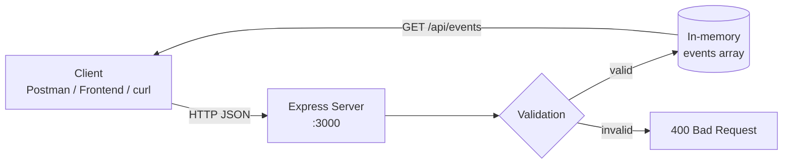

<div align="center">

# ⚽ FAP — Football Analysis App

**A lightweight REST backend for logging and tracking football match events: goals, cards, substitutions and more.**

[](https://nodejs.org/)
[](https://expressjs.com/)
[](https://opensource.org/licenses/ISC)
[](#-contributing)
[](https://github.com/nimthakalkp/FAP/commits/main)

[Getting Started](#-getting-started) · [API Reference](#-api-reference) · [Roadmap](#-roadmap) · [Contributing](#-contributing)

</div>

---

## 📖 About

**FAP (Football Analysis App)** is a backend service built with [Express 5](https://expressjs.com/) that records in-match football events. Each event says **what** happened (`type`), **who** did it (`player`) and **when** it happened (`minute`). Coaches, analysts and other apps can then read the events back.

The project is at an early stage. It is meant to grow into a full team-tracking and match-analysis platform.

> [!NOTE]
> Events are currently kept **in memory**, so all data is lost when the server restarts. Adding a database is on the [roadmap](#-roadmap).

## ✨ Features

- 📝 **Log match events**: record goals, assists, fouls, cards, substitutions or any other event type
- 📋 **List all events**: get every recorded event as JSON
- ✅ **Input validation**:
  - `type`, `player` and `minute` are all required
  - `minute` must be a whole number from `0` to `120` (covers extra time)
- ⚡ **Small and fast**: one dependency (`express`), no build step

## 🏗️ Architecture



## 🛠️ Tech Stack

| Layer     | Technology                                   |
| --------- | -------------------------------------------- |
| Runtime   | [Node.js](https://nodejs.org/) 18+           |
| Framework | [Express](https://expressjs.com/) 5          |
| Storage   | In-memory array (temporary)                  |
| Format    | JSON over HTTP                               |

## 📁 Project Structure

```text
FAP/
├── backend/
│   └── server.js        # Express app: routes, validation, server bootstrap
├── .gitignore           # Ignores node_modules and .env files
├── package.json         # Project metadata and dependencies
└── package-lock.json    # Locked dependency versions
```

## 🚀 Getting Started

### Prerequisites

- [Node.js](https://nodejs.org/) **v18 or newer** (Express 5 requires it)
- npm (included with Node.js)
- [Git](https://git-scm.com/)

### Installation

1. **Clone the repository**

   ```bash
   git clone https://github.com/nimthakalkp/FAP.git
   cd FAP
   ```

2. **Install dependencies**

   ```bash
   npm install
   ```

3. **Start the server**

   ```bash
   node backend/server.js
   ```

4. The server starts at **http://localhost:3000**. You should see:

   ```text
   Server is running on http://localhost:3000
   ```

> [!TIP]
> Add a `start` script to `package.json` so you can run `npm start`:
>
> ```json
> "scripts": {
>   "start": "node backend/server.js",
>   "dev": "node --watch backend/server.js"
> }
> ```
>
> `node --watch` restarts the server automatically whenever you save a file.

## 📡 API Reference

Base URL: `http://localhost:3000`

| Method | Endpoint      | Description                  |
| ------ | ------------- | ---------------------------- |
| `GET`  | `/`           | Health check                 |
| `GET`  | `/api/events` | Get all recorded events      |
| `POST` | `/api/events` | Record a new match event     |

### `GET /`

Checks that the server is running.

**Response:** `200 OK`

```text
Football Analysis Backend is working!
```

### `GET /api/events`

Returns every event recorded since the server started.

**Response:** `200 OK`

```json
[
  { "type": "goal", "player": "Silva", "minute": 23 },
  { "type": "yellow card", "player": "Perera", "minute": 41 }
]
```

### `POST /api/events`

Records a new event.

**Request body**

| Field    | Type             | Required | Rules                              |
| -------- | ---------------- | :------: | ---------------------------------- |
| `type`   | `string`         | ✅       | e.g. `goal`, `assist`, `foul`      |
| `player` | `string`         | ✅       | Player name                        |
| `minute` | `integer`        | ✅       | Whole number from `0` to `120`     |

**Example request**

```bash
curl -X POST http://localhost:3000/api/events \
  -H "Content-Type: application/json" \
  -d '{"type": "goal", "player": "Silva", "minute": 23}'
```

**Success:** `201 Created`

```json
{
  "message": "Event saved successfully!",
  "event": { "type": "goal", "player": "Silva", "minute": 23 }
}
```

<details>
<summary><strong>Error responses</strong></summary>

**`400 Bad Request`**: a required field is missing

```json
{ "message": "Please provide type, player, and minute." }
```

**`400 Bad Request`**: `minute` is invalid (not a whole number, below 0 or above 120)

```json
{ "message": "Minute must be a whole number between 0 and 120." }
```

</details>

<details>
<summary><strong>PowerShell example (Windows)</strong></summary>

```powershell
Invoke-RestMethod -Uri http://localhost:3000/api/events -Method Post `
  -ContentType "application/json" `
  -Body '{"type":"goal","player":"Silva","minute":23}'
```

</details>

## 🗺️ Roadmap

- [x] Express server setup
- [x] Create and list match events
- [x] Request validation
- [ ] Database storage (MongoDB / PostgreSQL)
- [ ] Teams, players and matches as separate resources
- [ ] Update and delete events (`PUT` / `DELETE`)
- [ ] Filter events by player, type or minute range
- [ ] Match statistics and player performance analysis
- [ ] Frontend dashboard
- [ ] Environment-based config (`PORT` from `.env`)
- [ ] Automated tests and GitHub Actions CI

See the [open issues](https://github.com/nimthakalkp/FAP/issues) for proposed features and known issues.

## 🤝 Contributing

Contributions are welcome.

1. Fork the project
2. Create a feature branch: `git checkout -b feature/amazing-feature`
3. Commit your changes using [Conventional Commits](https://www.conventionalcommits.org/): `git commit -m "feat: add player stats endpoint"`
4. Push the branch: `git push origin feature/amazing-feature`
5. Open a [Pull Request](https://github.com/nimthakalkp/FAP/pulls)

> [!IMPORTANT]
> Never commit `.env` files or secrets. They are already listed in `.gitignore`.

## 📄 License

This project is licensed under the **ISC License** (as declared in `package.json`). Add a `LICENSE` file to the repository root to make the terms explicit.

## 👤 Author

**nimthakalkp**: [@nimthakalkp](https://github.com/nimthakalkp)

---

<div align="center">

If you find this project useful, please give it a ⭐ on GitHub.

</div>
